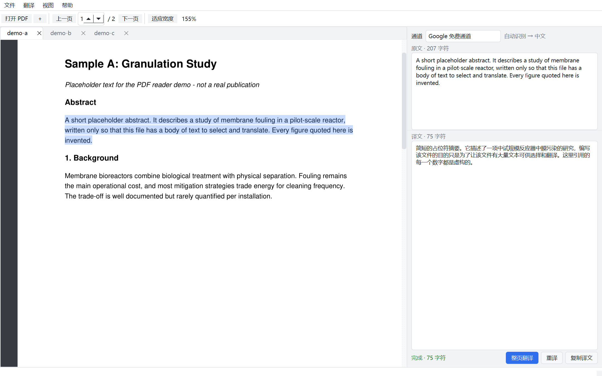

# PDFTrans · PDF 论文翻译

[](LICENSE)
[](https://www.python.org/)
[](#)

多标签 PDF 阅读 + 划词翻译的桌面工具（Windows）。左边读论文，选中英文就在右边出中文，
译文流式显示；翻译通道可以自由切换——免 key 的 Google / Bing，或者百度 / 有道 / DeepL 的官方
API，也可以接任意 **OpenAI 兼容**的大模型（DeepSeek、通义千问、Kimi、智谱、硅基流动、OpenRouter、
本地 Ollama…）。



## 特性

- **多标签**：一个窗口同时开多篇文献，各自的页码、缩放、滚动位置、选区互不干扰；右侧翻译栏共享。
- **划词即译**：单击翻整句，拖动翻任意片段（可跨行跨页），双击翻整段；粒度可在设置里改。
- **整页翻译**：`Ctrl+Enter` 把当前页正文按段落拼好一次翻完。
- **流式输出**：AI 通道逐字返回，不用等整段生成。
- **六种通道**：Google / Bing（免 key，开箱可用）、百度、有道、DeepL、OpenAI 兼容大模型。
- **本地缓存**：SQLite 按「通道 + 语向 + 原文」哈希去重，重复段落不再请求。
- **三套主题**：默认 / 护眼 / 夜间。
- **拖放打开**：把 PDF 拖进窗口即可，支持一次拖多个。
- **学术翻译提示词**：内置「忠实、术语、公式与引用标记保原样、只输出译文」的约束，可自行改写。

## 安装（从源码运行）

需要 Python 3.10+。

```bat
git clone https://github.com/ttdisme/pdftrans.git
cd pdftrans
python -m pip install -r requirements.txt
python main.py
```

或者双击 `run.bat`（会自检依赖并自动安装）。也可以把 PDF 作为参数：

```bat
python main.py paper.pdf
```

## 打包成 exe

双击 `build.bat`：装 PyInstaller（如缺）→ 生成图标 → 打包。产物是目录模式的运行包：

```
dist\PDFTrans\
  PDFTrans.exe              主程序（带图标与中文版本信息）
  _internal\                运行时依赖，必须和 exe 放在一起
  创建桌面快捷方式.bat         双击在桌面生成带图标的快捷方式
```

手动等价命令：

```bat
python -m pip install pyinstaller
python tools\make_icon.py
python -m PyInstaller --noconfirm --clean pdftrans.spec
```

为什么是目录模式而不是单文件：单文件版启动时要把上百 MB 解压到 `%TEMP%`，在部分环境会被
安全策略拦掉（报 `Could not create temporary directory!`），并且冷启动要好几秒。目录模式不写
临时目录、启动 1–2 秒。想要单文件可自行把 spec 里的 `COLLECT(...)` 换成把 `a.binaries`/`a.datas`
塞回 `EXE(...)`。

## 翻译通道怎么配

设置（`Ctrl+,`）分三页。

**在线引擎** —— 填厂商 key：

| 通道 | 需要什么 |
| --- | --- |
| 百度翻译 | APPID + 密钥（通用文本翻译 API） |
| 有道智云 | 应用 ID + 应用密钥 |
| DeepL | Auth Key（免费版端点 / 付费版 / 自建代理） |

**AI 大模型** —— 选服务商 →「套用预设」自动填 Base URL 和模型名，再填自己的 API Key：

| 预设 | Base URL | 模型示例 |
| --- | --- | --- |
| DeepSeek | `https://api.deepseek.com/v1` | `deepseek-chat` |
| 阿里千问 | `https://dashscope.aliyuncs.com/compatible-mode/v1` | `qwen-plus` |
| Kimi | `https://api.moonshot.cn/v1` | `moonshot-v1-8k` |
| 智谱 GLM | `https://open.bigmodel.cn/api/paas/v4` | `glm-4-flash` |
| 硅基流动 | `https://api.siliconflow.cn/v1` | `Qwen/Qwen2.5-7B-Instruct` |
| OpenRouter | `https://openrouter.ai/api/v1` | `openai/gpt-4o-mini` |
| 本地 Ollama | `http://127.0.0.1:11434/v1` | `qwen2.5:7b` |

- 「额外参数」透传给 `/chat/completions`，例如 `{"enable_thinking": false}`。
- 「系统提示词」就是学术翻译的约束，可自行改写。
- 「测试当前通道」会发一句英文试翻，直接看到返回或报错原因。

免 key 通道实现说明：
- **Google**：`translate_a/single`（POST，按 4500 字符分段）。
- **Bing**：网页版 `ttranslatev3`，先抓页面里的 `IG` / `IID` / `AbusePreventionHelper` 再提交。
这两个接口都不是官方 API，随时可能变更；厂商 key 或 AI 通道更稳。

## 快捷键

| 快捷键 | 作用 |
| --- | --- |
| `Ctrl+O` | 打开 PDF（可多选，每个一个标签） |
| `Ctrl+W` | 关闭当前标签 |
| `Ctrl+Tab` / `Ctrl+Shift+Tab` | 切换标签 |
| `Ctrl+Shift+T` | 翻译选区 |
| `Ctrl+Enter` | 翻译当前整页 |
| `Ctrl+Shift+V` | 翻译剪贴板 |
| `Ctrl+滚轮` / `Ctrl+0` / `Ctrl+9` | 缩放 / 适应宽度 / 适应整页 |
| `PageUp` / `PageDown` | 翻页 |
| `Esc` | 清除选区 |
| `Ctrl+,` | 设置 |

## 数据与缓存

- 配置：`%APPDATA%\PDFTrans\config.json`
- 缓存：`%APPDATA%\PDFTrans\cache.sqlite3`
- 若 `%APPDATA%` 不可写，自动改用 exe 旁边的 `data\` 目录，再不行退到 `%TEMP%\PDFTrans`，
  可用环境变量 `PDFTRANS_DATA_DIR` 强制指定。

## 自检与排障

```bat
PDFTrans.exe --selftest examples\sample-paper.pdf --shot a.png --translate --drop
```

会起窗口开标签、真翻一句、模拟一次拖放、截图并写 `a.log`（`tabs=` / `pages=` / `data_dir=` /
`cache_error=` / `drop_pages=` / `translate=`），退出码 0 表示正常。崩溃日志写在数据目录下的
`startup-error.log`，缓存不可用时另记 `cache-error.log`。

## 项目结构

```
main.py                 入口（异常日志 + 应用图标 + 自检模式）
build.bat               一键打包
pdftrans.spec           PyInstaller 配置
run.bat                 从源码启动
assets/                 app.ico / app.png（图标，由脚本生成）
examples/               示例 PDF（由脚本生成，无真实内容）
docs/                   截图
tools/
  make_icon.py          矢量生成图标（QPainter）
  make_sample_pdf.py    生成示例 PDF
  version_info.txt      exe 版本信息
pdftrans/
  config.py             配置模型、AI 预设、导入导出
  cache.py              SQLite 翻译缓存
  engines.py            6 个通道实现（Google/Bing/百度/有道/DeepL/AI 流式）
  pdfdoc.py             字符级文本层：bbox、行列、区间取文、句/段扩展
  resources.py          资源路径（源码 / 打包两用）
  worker.py             TranslateWorker + TranslateTask(QThread)
  ui/
    mainwindow.py       多标签主窗口：菜单、工具栏、主题、最近文件
    pdfview.py          连续滚动阅读区、懒渲染、字符级拖选
    panel.py            右侧原文 / 译文面板
    settings.py         设置对话框（含通道自测）
    styles.py           三套配色
```

## 已知限制

- 加密 PDF 只尝试空密码；带 DRM 的不支持。
- 扫描版（无文字层）PDF 不 OCR，会明确提示。
- 多栏排版按 PDF 的 block 切段，个别期刊的跨栏 block 可能把两栏并成一段。
- AI 通道长文本按 3800 字符切块顺序翻译，保序拼接，不保证跨块指代一致。
- 仅测试了 Windows；Qt 部分理论上跨平台，但打包脚本是 Windows 的。

## License

MIT，见 [LICENSE](LICENSE)。
